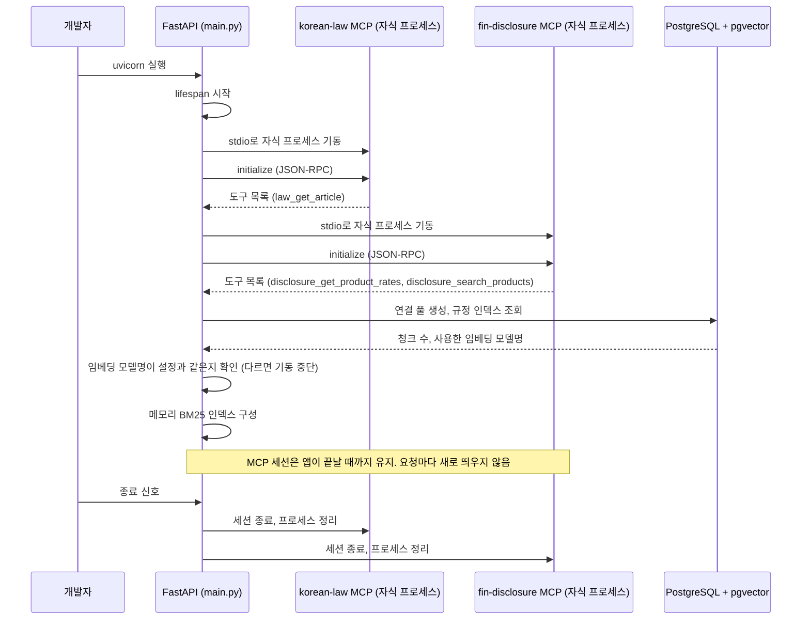
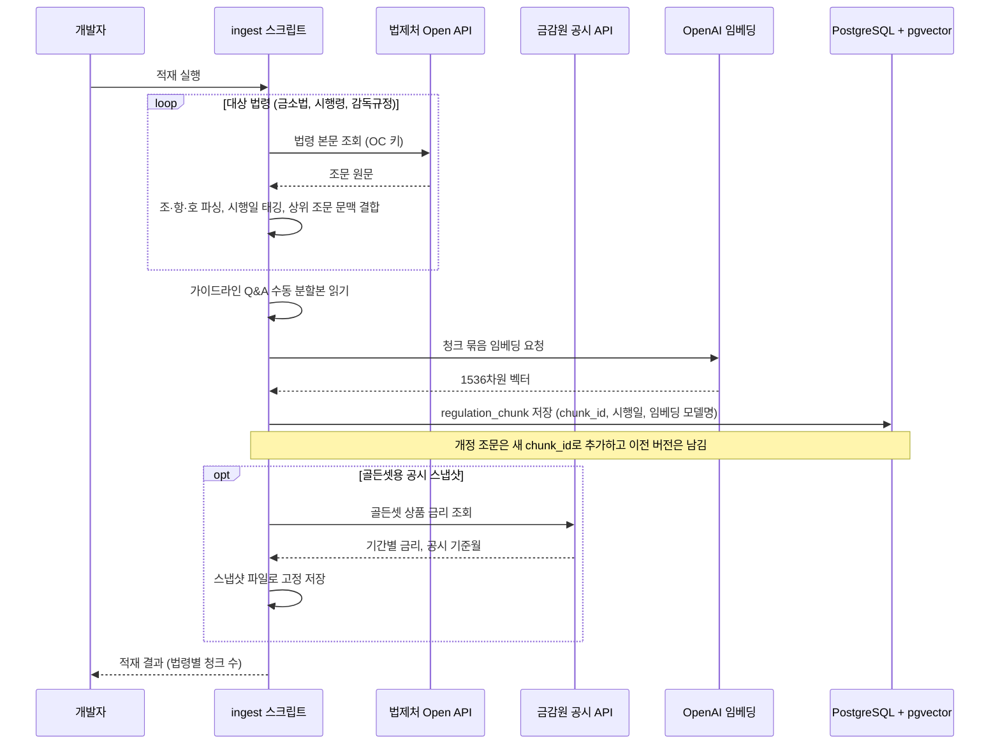
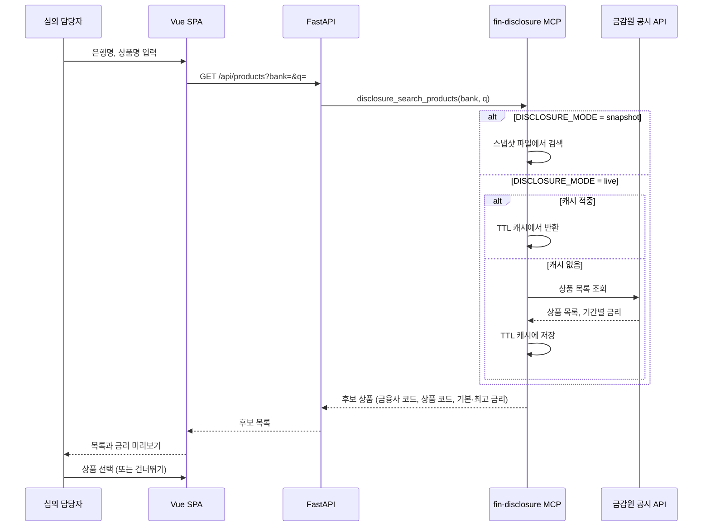
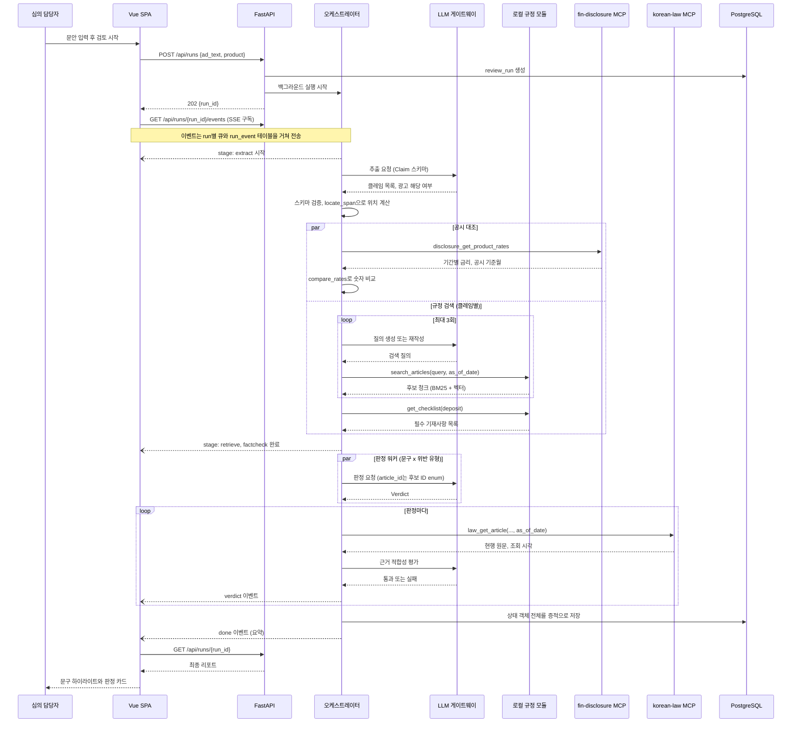
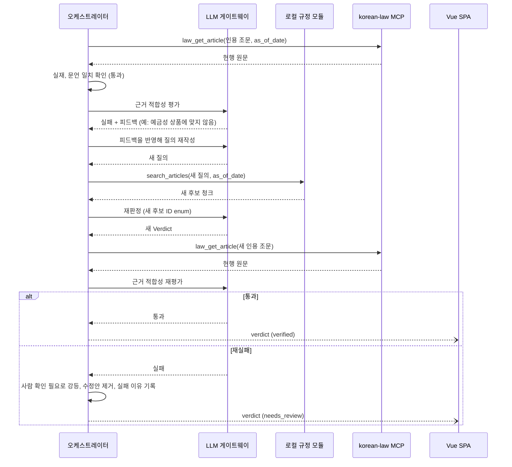
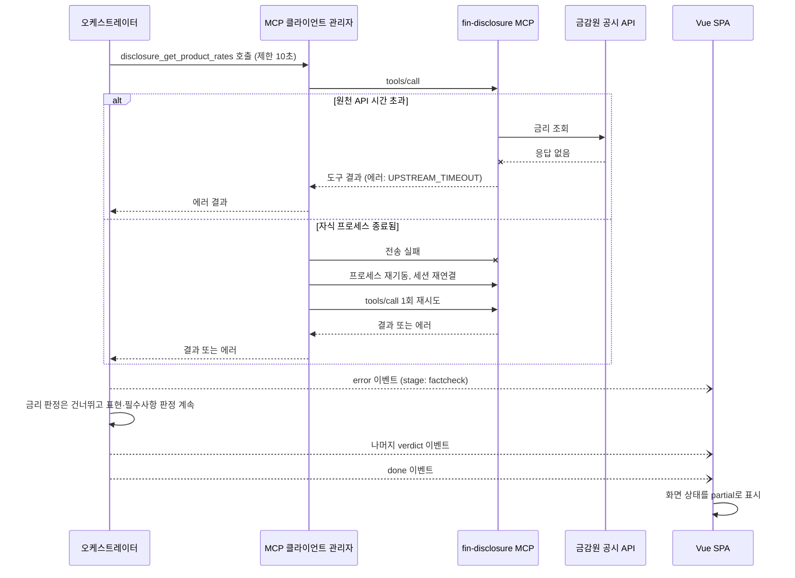
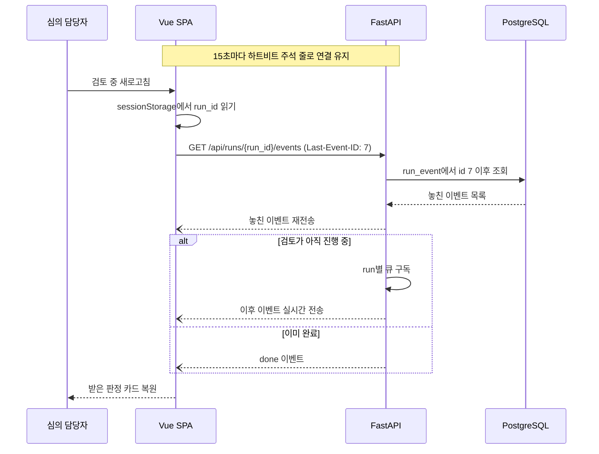
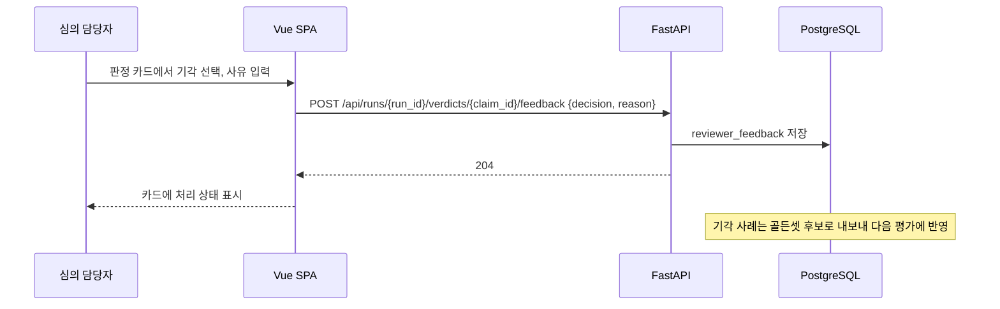
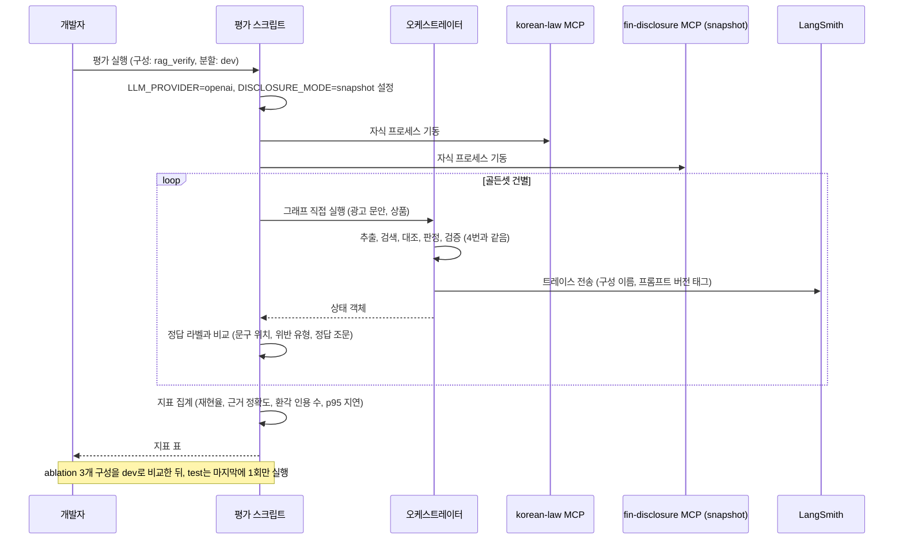

# RedPen — 유스케이스별 시퀀스 다이어그램 (2일 MVP)

> 기준 문서: 개발 준비 계획, 유저 플로우, ADR-001~012
> 표기: 실선(`->>`)은 호출, 점선(`-->>`)은 응답, 열린 화살표(`--)`)는 SSE 이벤트처럼 비동기로 흘려보내는 메시지입니다.

## 공통 참여자

| 약어 | 참여자 | 비고 |
| --- | --- | --- |
| U | 심의 담당자 | 유일한 사용자 |
| V | Vue SPA | Vue 3 + Vite 단일 페이지 |
| API | FastAPI 라우터 | `/api/*` REST + SSE |
| G | 오케스트레이터 | 상태 그래프, 에이전트 4개 실행 |
| L | LLM 게이트웨이 | 개발은 Ollama, 평가·데모는 OpenAI |
| KB | 로컬 규정 모듈 | `search_articles`, `get_checklist` (BM25 + pgvector) |
| ML | korean-law MCP | stdio 자식 프로세스 |
| MF | fin-disclosure MCP | stdio 자식 프로세스 |
| DB | PostgreSQL + pgvector | 규정 인덱스, 실행 증적, 이벤트 |
| LAW | 법제처 Open API | 외부 |
| FSS | 금감원 공시 API | 외부 |
| EMB | OpenAI 임베딩 | text-embedding-3-small 고정 |

---

## 1. 앱 기동과 종료

FastAPI가 `lifespan`에서 MCP 서버 2개를 자식 프로세스로 한 번만 띄우고, 종료할 때까지 세션을 유지합니다 (ADR-002).

---

## 2. 규정 적재 (ingest)

앱과 분리된 스크립트입니다. 조문을 조·항·호 단위로 잘라 시행일을 붙이고, OpenAI 임베딩으로 인덱스를 만듭니다 (ADR-011).

---

## 3. 공시 상품 검색과 선택

담당자가 광고 대상 상품을 고릅니다. 평가 중에는 스냅샷 모드로 동작해 결과가 바뀌지 않게 합니다.

---

## 4. 광고 검토 실행 (핵심 흐름)

실행과 구독을 나눕니다. `POST`는 백그라운드 실행만 시작하고, 진행 상황은 SSE로 흘려보냅니다 (ADR-005, 006).

---

## 5. 인용 검증 실패와 강등

조문은 실재하고 문언도 맞지만 판정을 뒷받침하지 않는 경우(misgrounded)입니다. 1회 되돌린 뒤에도 실패하면 숨기지 않고 "사람 확인 필요"로 넘깁니다.

---

## 6. 외부 API 장애와 부분 결과

한 단계가 실패해도 이미 받은 판정은 유지하고, 실패한 단계만 표시합니다. 에러는 예외가 아니라 도구 결과로 돌아옵니다.

---

## 7. SSE 재연결과 새로고침 복구

이벤트마다 `id`를 붙이고 DB에도 저장하므로, 끊겼다 붙어도 놓친 이벤트부터 다시 받습니다.

---

## 8. 판정 동의·기각 (시간 남으면)

담당자의 기각 사유는 오탐 데이터가 되어 골든셋 후보로 쌓입니다.

---

## 9. 골든셋 평가 실행

평가는 HTTP를 거치지 않고 그래프를 직접 실행합니다. 공급자는 OpenAI, 공시는 스냅샷으로 고정합니다 (ADR-010).

